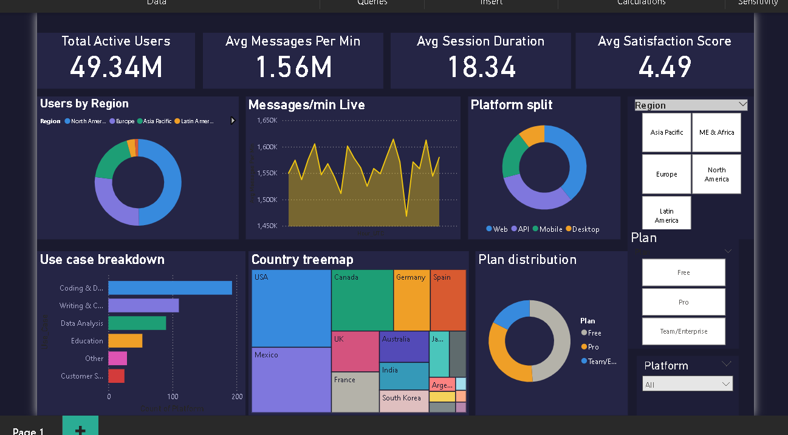
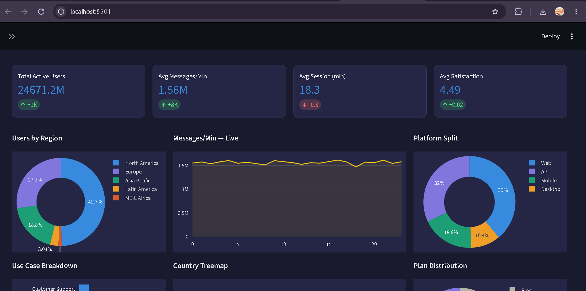

## ⚡ Claude Worldwide — Live Analytics Dashboard

Real-time global usage analytics dashboard to monitor user activity, messaging trends, platform usage, and subscription plans through interactive visualizations.

## 📸 Dashboard Preview

### 1. Power BI Dashboard



### 2. Streamlit Live Dashboard



## 🛠️ Tech Stack

* **Python:** Pandas, NumPy
* **Visualization:** Plotly
* **Business Intelligence:** Power BI
* **Web Dashboard:** Streamlit

## ✨ Features

* Automatic data refresh every 60 seconds
* Interactive charts for global usage analytics
* Regional user distribution
* Platform usage comparison
* Subscription plan distribution
* Use case and country-level analysis
* Dynamic filters for Region, Plan, and Platform

## 🚀 How to Run

Install the required libraries:

```bash
pip install streamlit plotly pandas numpy
```

Run the Streamlit dashboard:

```bash
streamlit run claude_streamlit_dashboard.py
```
## 📐 DAX Measures Used
- Total Active Users
- Avg Messages Per Min  
- Estimated Monthly Revenue
- Pro Plan Users / Enterprise Users
- Avg Satisfaction Score
- 
## 📊 Key Metrics

* Total Active Users
* Average Messages per Minute
* Average Session Duration
* Average Satisfaction Score

## 🎯 Project Objective

To explore global usage trends through interactive dashboards and demonstrate real-time data processing and visualization using Python, Streamlit, Plotly, and Power BI.
